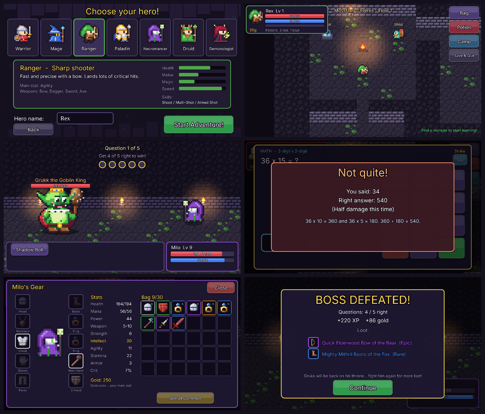

# Learning Dungeon



A top-down, turn-based dungeon crawler for a 4th grader. Every attack is a
question. Answer right for **full damage**, wrong for **half damage**, and the
game always shows the correct answer with a short explanation.

Questions follow the **Massachusetts 2017 Grade 4 curriculum frameworks**:

- **Math** (generated fresh every time, with step-by-step explanations):
  multiplication (facts, 2-digit x 1-digit, up to 4-digit x 1-digit,
  2-digit x 2-digit), division with remainders, long division, place value,
  rounding, comparing numbers, factors/multiples/primes, patterns, equivalent
  fractions, comparing fractions, adding and subtracting fractions, fraction x
  whole number, decimals, measurement conversions, area and perimeter, angles,
  and word problems.
- **Reading/vocabulary** (579 hand-written questions): synonyms, antonyms,
  vocabulary, context clues, prefixes and suffixes, Greek and Latin roots,
  figurative language, homophones, grammar, spelling, and short reading
  comprehension passages.

**Grades 3, 4 and 5** can be picked per hero (grade 4 is the full set; grade 3
is easier, and grade 5 adds 3-digit x 2-digit, dividing by 2-digit numbers,
order of operations, unlike fractions, decimal adding and subtracting, and
volume). Each time a hero is played, the child picks which topics to practice.
An **"I need a teacher!"** button explains how to think about the question
without giving away the answer.

Difficulty adapts per subject. Missed questions come back a few turns later.

## What's in v0.1

- **7 classes**: Warrior, Mage, Ranger, Paladin, Necromancer (summons
  skeletons), Druid, and Demonologist (summons an imp).
- **Spellbook**: each class has 10 spells; a new spell or a stronger rank
  (I/II/III) unlocks every 2 levels. Ranks of the same spell show as one card
  (e.g. Cleave) that always uses its best unlocked rank, with its current
  damage/heal and when the next rank comes. Pick **3** to bring into battle,
  plus a free basic attack. Mages get fire, ice, arcane and lightning, including
  spells that hit every enemy. Stronger spells cost a lot more mana.
  After every win a little mana comes back: 0.5% of max mana per point of
  Intellect (compounded), up to 25%. Potions are still needed.
  In a fight, mana comes back 2% per turn.
- **Ultimates change with your spells**: the power attack matches the school
  most of your 3 chosen spells use, e.g. Meteor (fire), Glacier Crash (ice),
  Arcane Nova (arcane), Thunderstorm (lightning), Starfall (druid moon magic).
  Every class has two schools: Warrior (melee + lightning), Ranger (arrows +
  nature), Paladin (holy + fire), Necromancer (shadow + ice), Druid (nature +
  moon), Demonologist (fel fire + shadow), Mage (fire, ice, arcane, lightning).
  The Spellbook shows which one you'll get.
- **Summons** (Necromancer skeleton, Demonologist imp): cast once and the pet
  follows you on the map and into every fight. It has about 1/3 of your
  health, and monsters can attack it and defeat it. Casting again heals or
  upgrades it, and the camp fountain heals it too.
- **Lighting**: caves are dark, with flickering torches and glowing campfires,
  portals and chests. Places outside the rooms and paths are just empty black.
- **Gear slots**: head, necklace, chest, gloves, pants, boots, 2 rings, main
  hand and off hand. Two-handed weapons (greatsword, greataxe, staff, bow) take
  both hands. One-handed weapons can be paired with a shield or spellbook.
- **Random loot**: Common, Uncommon, Rare, Epic and Legendary rarities, with
  random stats (Strength, Intellect, Agility, Stamina, Armor, Crit).
- **Area 1, Mossfang Caverns** (levels 1-10): 3 random cave floors, a camp
  with a healing fountain, a shop and fast travel, treasure chests. Boss:
  **Grukk the Goblin King**.
- **Area 2, Whisperwood Forest** (levels 11-20): a sunny outdoor forest with
  new monsters, reached through a portal that opens after beating Grukk. Boss:
  **Old Gnarlroot the Treant**. Level cap is now **20**.
- **Boss fights** are 5 questions and you need **4 of 5 (80%)** to win.
  Bosses can be farmed for Rare to Mythic loot.
- **Potions** in four strengths (Minor, Medium, Major, Superior) for health
  and mana. They drop from monsters and chests, scaled by monster level, and
  stronger ones unlock in the shop as you level up.
- **Game picker and free tier**: the app opens to a list of games. Every game
  is free to try with every grade and topic: Learning Dungeon's Mossfang
  Caverns (incl. Grukk), and Learning Farm up to 6 plots and 2 stalls. The full
  game ($3.99 each, or $7.99 for every game) unlocks the rest (store purchases
  are not connected yet; limits are in `src/hub/games.ts`). Players who had
  heroes before the picker keep the full Learning Dungeon. Unlocking and the
  parent dashboard are behind a grown-ups check (type your birth year). The
  developer code on the picker unlocks everything.
- **Learning Farm** (second game, `src/farm`, `src/scenes/Farm*.ts`): plant
  crops that keep growing while the app is closed, harvest them and sell them
  at the market (a right answer pays full price, a wrong one half). Animals get
  hungry (a red ! appears); answer a question to feed them (1 right, or 3
  tries, makes them happy). Happy animals earn a little income. Spend coins on
  a bigger garden, more stalls, and pigs, chickens, goats and horses.
  Neighbours post orders on the order board (bonus coins), harvests are
  sometimes golden (worth 5x), farmer gear gives bonuses (Watering Can, Lucky
  Straw Hat, Comfy Brush, Big Basket, Golden Bell), and animals can be renamed
  and dressed up in hats.
  In the full game, the Magic Portal (1,000 coins) opens a second farm in a
  magic world: crystal house, enchanted barn, magic crops (rainbow carrots,
  star fruit, moon melons, crystal berries, dragon peppers) and magic animals
  (fairies, unicorns, griffins, baby dragons). Coins and gear are shared
  between the two farms.
- **English and French**: pick the language on the title screen, the hero
  screen or the parent dashboard (each hero keeps its own language). French
  heroes get questions from the Quebec curriculum for 1re, 2e and 3e annee:
  early math (counting, adding and subtracting, money in Canadian coins, time,
  shapes, first multiplication and fractions) and a French reading bank
  (sounds and syllables, vocabulary, spelling, homophones, grammar, short
  stories). Read-aloud uses a French voice. All game text is translated
  (`src/i18n`).
- **Skill ladders** (`src/questions/ladders.ts`): every topic group is a
  ladder from very basic (below grade) to a bit above grade. Each group moves
  on its own: right answers climb, wrong answers step down (e.g. 7 x 143 ->
  2-digit x 1-digit -> times tables -> "groups of"). The topic screen shows
  each group's strength (Strong / Good / Needs practice / New) and current
  grade level; "Skills & levels" (grown-ups) shows accuracy and lets a parent
  pin a group to a grade.
- **Parent dashboard** (Parents button on the title screen, behind the grown-ups check): accuracy by
  topic, weakest first. You can also set the math/reading mix and turn on
  read-aloud.
- **Sound**: chiptune music for the menus, dungeon, battles and the boss, plus
  sound effects for every attack, spell, answer, level-up and treasure chest. All
  of it is synthesized in code (`src/audio/audio.ts`), with no audio files. The
  Sound button switches between all sound on, music off, and all sound off.
- Up to 3 hero save slots. Saves are on the device for now; cloud login comes
  next.

## Playing it

### In a browser (quickest)
```bash
npm install
npm run dev        # then open the printed URL on the tablet (same Wi-Fi)
```
Once the repo is on GitHub with Pages enabled (Settings -> Pages -> Source:
GitHub Actions), every push publishes a playable web version.

### On Android (the app)

Every update builds a new Android app. On the tablet, open this link in the
browser (or tap **Get the Android app** on the game picker in the website):

https://github.com/PantTent/Learning-Dungeon/releases/download/android-latest/LearningDungeon.apk

Open the downloaded file and allow installing from the browser if asked. To
update, download and install the newest one the same way: every build is
signed with the same sideload key (`android/sideload.keystore`, for our own
devices only, not a store key) and has a higher version number, so it installs
over the old app and keeps the saved games. The app runs full screen in
landscape, works offline, and keeps the screen on while playing.

### Moving saves (website <-> app, or between devices)

The app and the website keep their own saves. To move them, on the game
picker tap **Move my save** (grown-ups check), then **Make my save code** on
the device that has the save; it copies a code. On the other device (or in the
app on the same tablet), open **Move my save**, paste the code and tap **Load
this save**. It moves heroes, the farm, unlocked games and settings, and
replaces what was on that device.

### As a home-screen web app (Android or iPad)

Open the website, then use the browser's **Add to Home screen**. It opens full
screen in landscape and works offline (it always loads the newest version when
online).

To remake the app icons after changing the art: `python3 tools/art/make_icons.py`.

## Project layout

| Path | What |
|---|---|
| `src/questions/` | Math generators, reading bank, adaptive question engine (+ tests) |
| `src/data/` | Classes, items/loot, enemies, map generator |
| `src/state/` | Hero profile, stats, equip rules, saving; current dungeon floor |
| `src/scenes/` | Title, hero creation, dungeon map, battle, inventory, shop, parent screen |
| `src/ui/` | Buttons, bars, question overlay |
| `src/art/pixelData.ts` | All pixel art, generated by `tools/art/gen.py` |
| `tools/art/` | Editable sprite grids (`src_*.py`). Run `python3 gen.py` to rebuild the art and `python3 render.py` for a preview sheet |
| `android/` | Capacitor Android project |

## Tests
```bash
npm test
```
The tests check every math generator against independently computed answers,
validate all 579 reading questions, and cover the equip rules (two-handed and
off-hand, rings), the level cap, and the boss's 4-of-5 rule.

## Roadmap
- Cloud save + login (Google / email) so progress follows the child across devices
- More areas
- Full 3D art with gear that shows on the hero (try the preview: `preview3d.html`)
- iOS build
